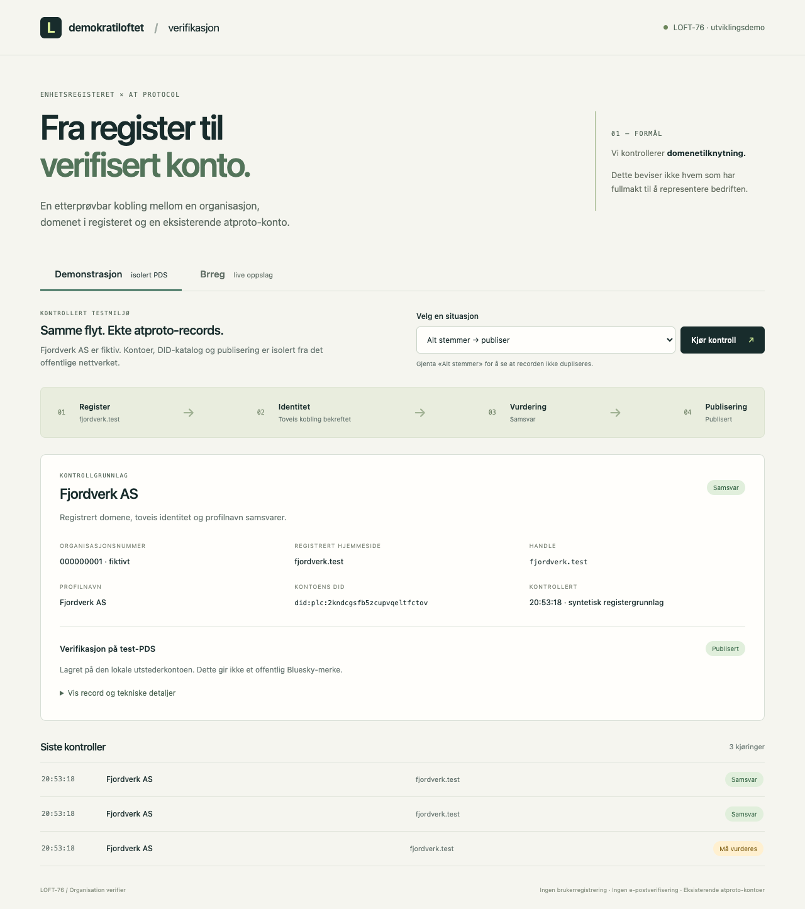

# Organisation verifier

Et kjørbart utgangspunkt for **LOFT-76**: koble en organisasjon i Enhetsregisteret til en eksisterende atproto-konto via registrert hjemmeside, og publisere en verifikasjon fra en utstederkonto.

To moduser:

- **Demonstrasjon:** fiktivt registergrunnlag, ekte DID-katalog og PDS. Viser publisering, omkjøring uten duplikater, nettverksfeil og tilbaketrekking.
- **Brreg live:** direkte API-oppslag og toveis kontroll av offentlige atproto-identiteter. Kun lesing; ingen offentlig publisering.

Dette verifiserer **domenetilknytning**, ikke en persons juridiske fullmakt. Publisering gir heller ikke automatisk et synlig Bluesky-merke.

Autentisert operatørside: [åpne verifikasjon](https://verifikasjon.demokratiloftet.no/).
[Veiledning for kontoeiere: DNS, well-known og kontrollkrav](https://verifikasjon.demokratiloftet.no/?veiledning).
[Enkel forklaring og drift](docs/internet.md).

## Start

Krever Docker Compose, Node **24.17** og pnpm **11.8**.

```sh
gh repo clone demokratiloftet/organisation-verifier
cd organisation-verifier
corepack enable
pnpm install --frozen-lockfile
pnpm demo:up
```

Åpne **http://127.0.0.1:3012**. Bruk denne adressen, siden vert og Origin kontrolleres.

Velg «Alt stemmer», kjør to ganger, og velg deretter «Profilnavnet endres». Utvid recorden for å se hva som ble publisert og trukket tilbake. [Demomanus og opptak](docs/demo.md).

```sh
pnpm check             # typer, tester og bygg
pnpm test:worker-integration # varig worker mot den isolerte PDS-en
pnpm test:integration  # krever demo:up; leser og kontrollerer records på den ekte test-PDS-en
pnpm format:check
pnpm demo:down         # stopper demoen; beholder SQLite-volumet
```

**Testnettverket er disponibelt:** PDS-kontoer og DIDs opprettes på nytt når fixture-containeren starter på nytt. Appens SQLite-historikk består. Gamle records vises ikke som aktive records i et nytt testnettverk.

## Videre arbeid

[Arkitektur og figurer](docs/architecture.md) · [Beslutninger og delegerbare oppgaver](docs/roadmap.md) · [VPS og drift](docs/operations.md)

Utførte kontroller er beskrevet i [valideringsloggen](docs/validation.md).

All vedlikeholdt applikasjonskode, nettleserkode, tester og fixture er strict TypeScript.
`pnpm build` kompilerer til `dist/` og kopierer statiske sider dit. Begge
containerbilder kjører kompilert JavaScript på låst Node 24.17.0 uten TypeScript-verktøy.
Fixture kan typekontrolleres separat med `pnpm --dir fixture install --frozen-lockfile`
og `pnpm --dir fixture typecheck`; CI gjør dette automatisk.

Fastify, SQLite og atproto-SDK brukes. Ingen frontend-rammeverk er nødvendig for dette kontrollpanelet. Policy, kilder, lagring og publisering ligger i hver sin modul under `src/`.

Bakgrunnstjenesten er nå implementert: strømmet registerimport, varig jobbkø,
Brreg-endringer, Jetstream v2, periodiske kontroller og en avgrenset offentlig
publisher. Alt er avslått som standard. Se [automatikk, foreløpig policy og
pilotoppsett](docs/automation.md) for oppstart og gjenstående aktivering.
Den offentlige piloten utsteder for Devotta fra Demokratiloftets egen konto; se
[utsteder og bekreftet pilot](docs/public-issuer.md). Fullregisteret er importert,
men førstegangskontrollene pågår. Se [kort restliste for LOFT-76](docs/roadmap.md).



## Sikkerhet og vedlikehold

CI kontrollerer formatering, typer, tester, bygg, ekte PDS-integrasjon,
avhengigheter i både app og fixture, og hele Git-historikken for hemmeligheter.
Actions er låst til commit-SHA-er. Se [sikkerhetspolicy](SECURITY.md).
Fixture er oppdatert til dev-env 0.6.14 med samme sikkerhetsoverstyringer som den
isolerte `local-sandbox`; bare testede PDS/PLC-funksjoner skal brukes.

Operatørappen bruker loopback lokalt og HTTPS med operatørinnlogging på VPS-en. Live-oppslag er kun lesing. Nettverksfeil
skal aldri gi en ny positiv verifikasjon. Løpende VPS-oppdateringer er beskrevet i
[driftsveiledningen](docs/operations.md).
