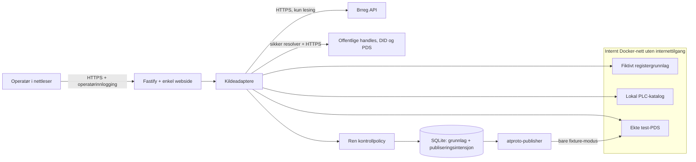

# Arkitektur

## Avgrensning

LOFT-76 handler om å finne **eksisterende** atproto-kontoer for registrerte organisasjoner. Ingen lager en bedriftsbruker i denne appen. Det er derfor ikke nødvendig med e-postverifisering, BankID, organisasjonsonboarding eller det eksisterende `identity-component` for å demonstrere denne oppgaven.

Registrert hjemmeside er en påstand i Brreg. Toveis handle/DID-kontroll viser kontroll over et domene og en konto. Sammen er dette et grunnlag for utstederens vurdering; det er ikke bevis på juridisk representasjonsrett. En produksjonspolicy må ta høyde for feil registrering, delte domener og flere enheter på samme domene.

## Komponenter



Appen har utgående tilgang for offentlige oppslag. Fixture-containeren har bare et internt Docker-nett. Ingen PDS-/PLC-porter publiseres på verten. Lokal standard binder `127.0.0.1:3012`; VPS-en bruker autentisert HTTPS på port 8443. Eksisterende tjenester på VPS-en brukes ikke eller endres.

| Fil                 | Ansvar                                                               |
| ------------------- | -------------------------------------------------------------------- |
| `src/domain.ts`     | URL/handle-regler, første gyldige DID-alias, ren beslutningsfunksjon |
| `src/sources.ts`    | Brreg API, offentlig identitetsoppløsning og separat fixture-adapter |
| `src/publisher.ts`  | Lexicon-validert record, stabil TID, gjenfinning og sletting         |
| `src/store.ts`      | SQLite, varig kontrollgrunnlag og publiseringsstatus                 |
| `src/app.ts`        | Validerte operatørendepunkter, én samtidig kjøring, webressurser     |
| `fixture/server.ts` | Offisiell `@atproto/dev-env`: lokal PLC og PDS med fiktive kontoer   |
| `public/`           | HTML, CSS og nettleser-TypeScript uten eksterne ressurser            |

## Kontrollflyten

```mermaid
sequenceDiagram
  actor O as Operatør
  participant A as App
  participant R as Registeradapter
  participant I as Identitetsadapter
  participant D as SQLite
  participant P as Utstederens test-PDS
  O->>A: Kjør kontroll
  A->>R: Hent organisasjon og hjemmeside
  R-->>A: Registergrunnlag
  A->>I: Hjemmeside → handle → DID
  I->>I: DID → første gyldige handle; må samsvare
  I->>I: Hent profil fra PDS
  I-->>A: Identitet og profilnavn
  A->>A: Vurder domene og navn
  A->>D: Lagre grunnlag og beslutning
  alt Fixture med samsvar
    A->>D: Lagre pending med valgt TID og createdAt
    A->>P: getRecord ved samme TID
    opt Recorden finnes ikke
      A->>P: putRecord med den lagrede recorden
    end
    A->>D: Marker published
  else Fixture med endret grunnlag
    A->>D: Marker revoking
    A->>P: getRecord; sjekk innhold; deleteRecord
    A->>D: Marker revoked
  else Live eller midlertidig feil
    A->>A: Ingen publisering
  end
  A-->>O: Resultat, grunnlag og publiseringsstatus
```

Publiseringsstatus er adskilt fra kontrollresultat: `match`, `no_match`, `needs_review`, `unavailable`. Ved midlertidig feil beholdes en eksisterende testrecord. Dette er ikke en ferdig produksjonspolicy for hvor lenge en verifikasjon kan leve uten oppdatert grunnlag.

## atproto-detaljer

Offentlig identitet bruker `@atproto/identity` med SSRF-beskyttet standardtransport. Resolveren støtter DNS/HTTPS-handleoppslag og DID-oppløsning. Profiloppslaget bruker `safeFetchWrap` med HTTPS, kontroll av IP-adresser ved tilkobling, begrenset responsstørrelse og tidsavbrudd. Private IP-er, egendefinerte porter og omdirigeringer aksepteres ikke i dette profiloppslaget.

Fixture-modus går bevisst til faste lokale endepunkter. Den løser faktiske handles via test-PDS, leser DID-dokumenter fra lokal PLC og sjekker tilbakeretningen. Fixture-passordet er en offentlig kjent testverdi; containeren må aldri eksponeres offentlig.

`app.bsky.graph.verification` inneholder:

```json
{
  "$type": "app.bsky.graph.verification",
  "subject": "did:plc:<kontoens DID>",
  "handle": "fjordverk.test",
  "displayName": "Fjordverk AS",
  "createdAt": "2026-10-07T12:00:00.000Z"
}
```

Recorden ligger i **utstederens** repository. Organisasjonsnummer og kontrollgrunnlag lagres lokalt; lexiconet har ikke egne felt for disse. Visning som et Bluesky-verifikasjonsmerke forutsetter at klientens tillitsmodell godtar utstederen.

En omkjøring gjenbruker TID og `createdAt`. Ukjent utfall etter et nettverksbrudd avklares med `getRecord`; vi utsteder ikke en ekstra record. Ukjent eller endret innhold på samme nøkkel holdes tilbake for manuell kontroll. Ny kontroll etter prosessrestart avklarer igjen. Den valgfrie bakgrunnsarbeideren kjører samme avstemming gjennom varige jobber. Se [automatikk](automation.md).

## Valgt demopolicy

- Registrert vertsnavn prøves først. Uten bekreftet konto prøves domenet uten én innledende `www.`. Nettverksfeil gir ikke fallback. PSL (inkludert private suffixes) hindrer at `www`-fallback ender på selve suffixet. Vi hopper ikke fra andre underdomener til foreldredomener.
- Sti, query, fragment, brukerinformasjon eller egen port krever vurdering.
- Første syntaktisk gyldige `at://`-alias i DID-dokumentet må være handle-kandidaten.
- Profilnavnet må samsvare med registernavnet etter normalisering av Unicode, mellomrom og store/små bokstaver. Dette er et konservativt demovalg, ikke en avklart forretningsregel.
- Slettet organisasjon, endret domene, brutt identitet eller avvikende navn skal ikke fortsette en automatisk testverifikasjon.
- Manuelle live-oppslag er read-only. Den valgfrie bakgrunnstjenesten har en egen offentlig transport med eksplisitt issuer-DID og pilotliste.

## Automatikk og driftsgrenser

`registry.ts` strømmer fullimport og lagrer registerendringer med cursor og jobber i
samme transaksjon. `store.ts` har indekser, additiv migrasjon og varige jobber.
`worker.ts` gjenbruker kontroll- og publiseringsflyten. `jetstream.ts` kølegger
nye kontroller; hendelser er aldri verifikasjonsbevis. `automation.ts` kjører dette
i samme prosess, med én verifier og begrenset Brreg-parallellitet.

Den offentlige adapteren skiller DNS-/HTTP-feil fra definitivt fravær, bruker
SSRF-beskyttet transport og henter kontostatus før profil. Feil gir retry, ikke
umiddelbar tilbaketrekking. Etter syv dager uten fullført kontroll utløper
verifikasjonen etter den foreløpige policyen.

[Automatikk og drift](automation.md) beskriver oppstart, backup, restore, overvåking
og foreløpige regler. Offentlig utstedelse og faktisk pilotakseptanse er fortsatt
separate operatørsteg. Kapasitet for en landsdekkende gjennomgang er ikke målt mot
hele det offentlige registeret.

Kilder: [AT Protocol identity](https://atproto.com/specs/identity), [handle-spesifikasjon](https://atproto.com/specs/handle), [verifikasjonslexicon](https://github.com/bluesky-social/atproto/blob/main/lexicons/app/bsky/graph/verification.json), [Brreg API-dokumentasjon](https://data.brreg.no/enhetsregisteret/api/docs/index.html).
