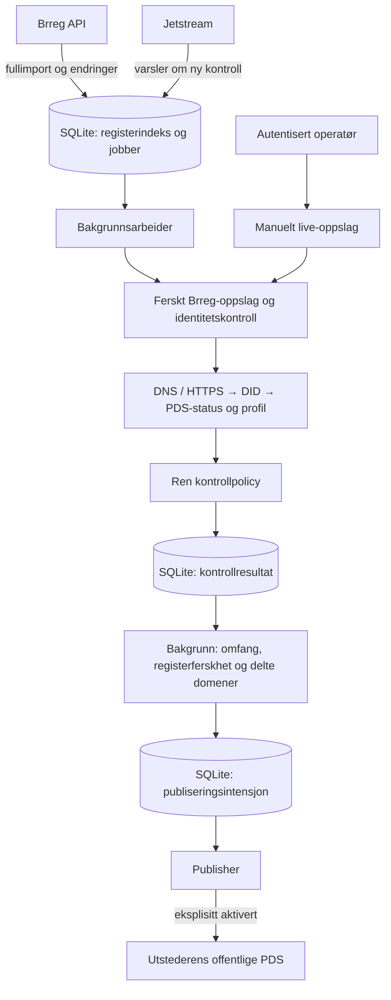

# Arkitektur

Tjenesten finner eksisterende atproto-kontoer fra hjemmesider i Enhetsregisteret.
Den oppretter ikke kontoer for organisasjonene. Brreg-hjemmesiden er en registrert
påstand; toveis domene/DID-kontroll og samsvarende profilnavn er grunnlaget for
utstederens verifikasjon. Det beviser ikke juridisk representasjonsrett.

## Dataflyt

Diagrammet viser live-data. Manuelle oppslag lagrer bare resultatet; de starter
ikke publisering. Demonstrasjonen bruker en separat adapter med fiktivt
registergrunnlag, lokal PLC-katalog og ekte isolert test-PDS.

## Moduler

| Modul               | Ansvar                                                                    |
| ------------------- | ------------------------------------------------------------------------- |
| `domain.ts`         | URL/handle-regler, navnenormalisering og ren beslutningsfunksjon          |
| `sources.ts`        | Brreg-enhetsoppslag, kontrollflyt og separat fixture-adapter              |
| `identity.ts`       | DNS/HTTPS-handle, DID-dokument, kontostatus og profil fra PDS             |
| `registry.ts`       | Strømmet fullimport, registerendringer og varig cursor                    |
| `jetstream.ts`      | Kølegge ny kontroll ved konto-/profilhendelser                            |
| `worker.ts`         | Hente grunnlag, vurdere delte domener og styre utstedelse/tilbaketrekking |
| `automation.ts`     | Registerpoll og begrenset pool i samme prosess                            |
| `publisher.ts`      | Validere record, lagre intensjon, avstemme og skrive/slette via SDK       |
| `store.ts`          | SQLite, indekser, kontrollhistorikk og jobber med tidsbegrenset eierskap  |
| `app.ts`, `public/` | Fastify og enkel operatørside uten frontend-rammeverk                     |

## Hvilke kilder brukes?

- Brreg: `/enheter/{orgnr}` for ferske oppslag, `/enheter/lastned` for gzip-import,
  `/oppdateringer/enheter` for endringer, under `https://data.brreg.no/enhetsregisteret/api`.
- Handle: DNS TXT på `_atproto.<handle>`, deretter HTTPS well-known ved behov.
- DID: `did:plc` via PLC-katalogen; `did:web` via domenets DID-dokument.
- Konto: PDS fra DID-dokumentet, med `com.atproto.sync.getRepoStatus` og
  `com.atproto.repo.getRecord` for `app.bsky.actor.profile/self`.
- Jetstream: konto-, identitets- og profilendringer gir nye jobber, aldri godkjenning.

Fullregisteret er en oppdagelsesindeks og brukes til konfliktkontroll. Positive
indekstreff kontrolleres på nytt med ferske kilder. Import skjer i bolker på 250;
hele filen holdes ikke i minnet. Cursor og tilhørende jobber lagres i samme transaksjon.
Se [automatikk](automation.md) for kommandoer, intervaller og gjenoppretting.

## Kontrollregler

- Bruk det registrerte vertsnavnet først. Bare ved fravær av bekreftet konto kan
  én innledende `www.` fjernes. Public Suffix List hindrer fallback til selve
  suffixet, også for delte plattformer. Andre foreldredomener prøves ikke.
- Sti, query, fragment, brukerinformasjon eller egen port gir vurderingsbehov.
- Første gyldige `at://`-alias i DID-dokumentet må være handle-kandidaten.
- Kontoen må være aktiv, og profilnavnet må samsvare etter Unicode-, mellomrom-
  og bokstavnormalisering. Ett avsluttende, separat `AS` i Brreg-navnet kan
  utelates i profilnavnet. `ASA`, `A/S`, prefikser og merkenavn får ingen unntak.
- Bakgrunnsarbeideren krever at profilnavnet matcher nøyaktig én organisasjon på
  domenet, gruppert med og uten `www`. Enheter med sti telles med. To navnetreff,
  også etter AS-unntaket, gir vurderingsbehov; eksakt navn får ikke forrang.
  Manuelle oppslag har ikke denne fullregisterkontrollen.
- Unikheten kontrolleres igjen rett før en ny record skrives. Navne- og
  domeneendringer kølegger berørte kontoer på nytt, også når domenet allerede deles
  av mange enheter. Path-baserte enheter uten kjent konto trenger ikke ny
  identitetskontroll selv, men teller fortsatt når unikheten vurderes.
- Usikre kilder gir `unavailable`, aldri godkjenning. Eksisterende verifikasjon
  beholdes ved kortvarig feil, men trekkes tilbake etter syv dager uten fullført kontroll.

## Publisering

En `app.bsky.graph.verification` inneholder kontoens DID (`subject`), handle,
profilnavn og `createdAt`, og lagres i **utstederens** repository. Organisasjonsnummer
og kontrollgrunnlag ligger bare i SQLite. Klienter må selv velge å stole på utstederen.

Før en ekstern write lagres `pending` med valgt TID (record-nøkkel) og innhold.
Publisheren leser samme nøkkel før den skriver. Etter tapt svar eller prosessrestart
avstemmes samme record; gjenforsøk lager ikke duplikater. Endret grunnlag lagrer
`revoking` før sletting. Avvikende innhold på samme nøkkel krever manuell kontroll.

Offentlig utstedelse krever eksplisitt konfigurasjon, valgt `pilot`/`all_matching`,
komplett og nylig avstemt register og fersk positiv kontroll. Endringer som kommer
mens et oppslag pågår, gjør kontrollen foreldet og utløser nytt arbeid.
Tilbaketrekking kan fortsette selv om registeret midlertidig er utilgjengelig.

## Nettverksgrenser

Offentlige identitetsoppslag bruker AT Protocol-SDK og SSRF-beskyttet transport
med HTTPS, kontroll av IP-adresser ved tilkobling, responsgrenser og tidsavbrudd.
Bare handle-oppslaget tillater HTTPS-omdirigeringer; hvert hopp kontrolleres.
DID-, profil- og statusoppslag følger ikke omdirigeringer. Utstederinnlogging er
låst til den konfigurerte PDS-origin og forventet DID.

Fixture bruker faste lokale endepunkter og et offentlig kjent testpassord. Den
har bare et internt Docker-nett, uten vertsporter eller internettilgang. Appen
har et separat nett for offentlige oppslag. Lokal UI binder loopback; internettdrift
krever HTTPS og operatørinnlogging på alle ruter.
