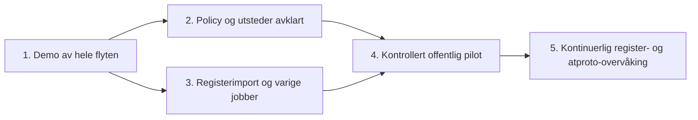

# Beslutninger og delegering

LOFT-76 er fortsatt fasiten for produktmålet. Repoet leverer en demonstrerbar kontroll- og publiseringsflyt, men fullfører ikke alle underoppgavene. Jira er ikke endret av dette arbeidet.

## Det Edvin bør avgjøre før offentlig utstedelse

| Beslutning                        | Forslag                                                            | Hvorfor det må avgjøres                                               |
| --------------------------------- | ------------------------------------------------------------------ | --------------------------------------------------------------------- |
| Hva utstederen garanterer         | Domenetilknytning til en Brreg-enhet                               | Ikke impliser juridisk fullmakt eller BankID-kontroll                 |
| Eksakt host eller foreldredomene  | Start eksakt; dokumenter unntak separat                            | `tenant.felles.no` må ikke verifisere `felles.no`                     |
| Flere enheter på samme domene/DID | Hold tilbake automatisk utstedelse                                 | Én nettside kan dekke konsern, filialer og helt andre enheter         |
| Registrert navn vs. merkenavn     | Avklar tillatte avvik og manuell overstyring                       | Dagens nøyaktige navnesammenligning vil avvise legitime merkenavn     |
| Utløp, feil og tilbakekalling     | Avtal maks alder, retry-vindu og definitive tilbakekallingsgrunner | En timeout er ikke bevis på at koblingen er borte                     |
| Utstederkonto og tillit           | Kjetil velger konto/handle på ønsket PDS                           | Kontoeierskap, nøkkelansvar og Bluesky-synlighet er separate spørsmål |
| Deling av kontrollgrunnlag        | Lokal historikk først; avklar offentlig bevisformat senere         | Standardrecorden inneholder ikke orgnr eller registerbevis            |

Dette blokkerer **ikke** arbeid på importer, adaptere, jobber og tester. Det blokkerer automatisk utstedelse av offentlige verifikasjoner med en uavklart betydning.

## Foreslått leveranserekkefølge

## Konkrete oppgaver

Estimatene er grove arbeidsstørrelser for utviklere som kjenner TypeScript. De er ikke leveringsløfter.

| Oppgave / Jira-kobling                                | Startpunkt                               | Ferdig når                                                                                                                                                         | Avhengighet / størrelse        |
| ----------------------------------------------------- | ---------------------------------------- | ------------------------------------------------------------------------------------------------------------------------------------------------------------------ | ------------------------------ |
| **Avklar verifikasjonspolicy** — LOFT-79/87           | `domain.ts`, beslutningstabellen over    | Policyversjon, delte domener, navn, tilbakekalling og minst ti positive/negative eksempler er godkjent                                                             | Edvin + Kjetil; 0,5–1 dag      |
| **Registeradapter og full import** — LOFT-77/80       | `fetchOrganisation`                      | Strøm `/enheter/lastned` med begrenset minne; idempotent upsert; gjenstartbar import; orgnr/host-indekser                                                          | Kan starte nå; 1–2 dager       |
| **Jobber og publiseringskø** — LOFT-80/84             | `Store`, `Publisher`                     | Varige, dedupliserte jobber med lease/retry/backoff; intensjon og jobboppdatering atomisk; restarttest; begrenset parallellitet                                    | Kan starte nå; 1–2 dager       |
| **Registerendringer** — LOFT-78                       | Registeradapter + jobber                 | `/oppdateringer/enheter` trigger nytt oppslag; cursor lagres først etter varig kølegging; inklusiv ID/overlapp håndteres; sletting testes                          | Import + kø; 1–2 dager         |
| **Robust identitetsoppløsning** — LOFT-79/87          | `resolveIdentity`                        | Timeout skilles fra manglende handle; DID-endring, deaktivert konto, SSRF og navnendring testes; foreldredomene bruker PSL dersom godkjent                         | Policy; 1–2 dager              |
| **Utstederkonto og offentlig publisher** — LOFT-82/83 | Egen implementasjon av `RecordRemote`    | Valgt konto og handle, secret-håndtering, plan/preview før writes, avgrenset pilotliste, gjennomført tilbakekalling; ingen fixture-data kan nå offentlig transport | Policy + konto; 1–2 dager      |
| **Jetstream som trigger** — LOFT-81/84                | Samme kontrolljobb som registerendringer | Identity/account/profilhendelser kølegger ny autoritativ kontroll; cursor/replay/deduplisering og gjenoppretting etter fravær testes                               | Jobbkø + indekser; 1–2 dager   |
| **Tilbakekalling og periodisk avstemming** — LOFT-88  | `Publisher.apply/reconcile`              | Varig tilbakekalling med samme URI; test av tapte svar; periodisk sjekk av faktisk PDS-innhold; slettede/deaktiverte kontoer; policy for gammelt grunnlag          | Policy + jobber; 1–2 dager     |
| **Drift og operatørtilgang**                          | `compose.yaml`, `operations.md`          | Godkjent autentisering, tilgangsroller, backup/restore-test, migrasjoner, logger/målinger/varsling og begrenset offentlig lesevisning                              | Før offentlig pilot; 1–2 dager |

**Brreg API eller JSON?** Begge har en plass. Direkte `/enheter/{orgnr}` brukes ved kontroll. API-et har også `hjemmeside`-filter for kandidatsøk, men søketreff må kontrolleres mot hele enheten. Vanlig søkepaginering er begrenset til 10 000 resultater. For en full innledende gjennomgang er den daglige bulkfilen et fornuftig utgangspunkt; etterpå brukes endrings-API-et. LOFT-77 bør beskrive dette, ikke anta at API-et mangler hjemmesidesøk.

**Initial import og endringer:** ta vare på en startcursor før snapshot-import, importer snapshotet og spill endringer fra startcursoren etterpå. Håndter overlapp idempotent. Ikke flytt cursor forbi en endring før jobben er varig lagret.

**Jetstream:** er en vekkerklokke, ikke verifikasjonsbevis. En hendelse skal føre til nytt register-, handle-, DID- og profiloppslag. Verken hendelsespayloaden eller et søketreff alene skal gi en verifikasjon.

## Forslag til svar til Kjetil

> Jeg har sett på LOFT-76 og laget et kjørbart grunnlag som demonstrerer register → domene → DID → verifikasjonsrecord, inkludert tilbaketrekking. Jeg er enig i hovedmålet. Jeg foreslår at vi presiserer hva vi faktisk verifiserer, hvordan vi håndterer delte/overordnede domener og avvik mellom firmanavn og profilnavn, og når en verifikasjon skal trekkes tilbake. Brreg har hjemmesidesøk i API-et, så enkeltkontroller og endringer kan bruke API-et direkte; bulkfilen er fortsatt nyttig til første gjennomgang av hele registeret. Jeg ville delt resten i registerimport, varige kontrolljobber, utsteder/publisering og hendelser som trigger nye kontroller. Identitetskomponenten og e-postverifisering er ikke nødvendige for denne flyten, siden vi finner eksisterende atproto-kontoer.
