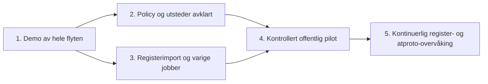

# Beslutninger og delegering

LOFT-76 er fortsatt fasiten for produktmålet. Repoet leverer en demonstrerbar kontroll- og publiseringsflyt, men fullfører ikke alle underoppgavene. Jira er ikke endret av dette arbeidet.

## Det Edvin bør avgjøre før offentlig utstedelse

| Beslutning                        | Forslag                                                            | Hvorfor det må avgjøres                                               |
| --------------------------------- | ------------------------------------------------------------------ | --------------------------------------------------------------------- |
| Hva utstederen garanterer         | Domenetilknytning til en Brreg-enhet                               | Ikke impliser juridisk fullmakt eller BankID-kontroll                 |
| Eksakt host eller foreldredomene  | Eksakt først; tillat kontroll uten innledende `www`                | `tenant.felles.no` må ikke verifisere `felles.no`                     |
| Flere enheter på samme domene/DID | Hold tilbake automatisk utstedelse                                 | Én nettside kan dekke konsern, filialer og helt andre enheter         |
| Registrert navn vs. merkenavn     | Avklar tillatte avvik og manuell overstyring                       | Dagens nøyaktige navnesammenligning vil avvise legitime merkenavn     |
| Utløp, feil og tilbakekalling     | Avtal maks alder, retry-vindu og definitive tilbakekallingsgrunner | En timeout er ikke bevis på at koblingen er borte                     |
| Utstederkonto og tillit           | Kjetil velger konto/handle på ønsket PDS                           | Kontoeierskap, nøkkelansvar og Bluesky-synlighet er separate spørsmål |
| Deling av kontrollgrunnlag        | Lokal historikk først; avklar offentlig bevisformat senere         | Standardrecorden inneholder ikke orgnr eller registerbevis            |

Dette blokkerer **ikke** arbeid på importer, adaptere, jobber og tester. Det blokkerer automatisk utstedelse av offentlige verifikasjoner med en uavklart betydning.

## Foreslått leveranserekkefølge

## Implementert 11. oktober 2026

Den opprinnelige arbeidslisten er nå implementert i kode. Dette endrer ikke Jira-status automatisk.

| Jira-kobling | Implementert                                                                                              | Gjenstår før offentlig drift                                                  |
| ------------ | --------------------------------------------------------------------------------------------------------- | ----------------------------------------------------------------------------- |
| LOFT-77/80   | Streamet snapshot-import, indekser, SHA-bundet gjenopptak og batchkø                                      | Kjør komplett import i valgt driftsmiljø; mål kapasitet                       |
| LOFT-80/84   | SQLite-jobber med lease, deduplisering, retry og varig publiseringsintensjon                              | Overvåk køalder i drift                                                       |
| LOFT-78      | Endringspoll, autoritative oppslag og atomisk cursor/jobb                                                 | Aktiver automatikk i miljøet                                                  |
| LOFT-79/87   | Foreløpig versjonert policy, delte domener, toveis identitet, kontostatus og skille mellom feil og fravær | Edvin/Kjetil bekrefter foreløpige regler                                      |
| LOFT-82/83   | SDK-publisher med fast issuer-DID/PDS, hemmelighet fra fil og eksplisitt pilotliste                       | Velg reell utsteder og positiv målkonto; gjennomfør offentlig pilot           |
| LOFT-81/84   | Jetstream v2, varig cursor, reconnect, deduplisering, gap-rescan og DID-oppdagelse                        | Følg kildehelse og kø under faktisk trafikk                                   |
| LOFT-88      | Automatisk tilbaketrekking, gjenforsøk, periodisk avstemming og syvdagers utløp ved uavklart kontroll     | Bekreft tidsvinduer og observer pilotens tilbaketrekking                      |
| Drift        | Additiv migrasjon, online backup, restore-test, readiness og operatørstatus                               | Kontrollert utrulling, ekstern backup og tilkobling til eksisterende varsling |

[Driftsoppsett og eksplisitte antakelser](automation.md) er gjeldende implementasjonsbeskrivelse.
Vi har ikke aktivert offentlig publisering eller satt opp en betrodd Bluesky-utsteder.

**Brreg API eller JSON?** Begge har en plass. Direkte `/enheter/{orgnr}` brukes ved kontroll. API-et har også `hjemmeside`-filter for kandidatsøk, men søketreff må kontrolleres mot hele enheten. Vanlig søkepaginering er begrenset til 10 000 resultater. For en full innledende gjennomgang er den daglige bulkfilen et fornuftig utgangspunkt; etterpå brukes endrings-API-et. LOFT-77 bør beskrive dette, ikke anta at API-et mangler hjemmesidesøk.

**Initial import og endringer:** ta vare på en startcursor før snapshot-import, importer snapshotet og spill endringer fra startcursoren etterpå. Håndter overlapp idempotent. Ikke flytt cursor forbi en endring før jobben er varig lagret.

**Jetstream:** er en vekkerklokke, ikke verifikasjonsbevis. En hendelse skal føre til nytt register-, handle-, DID- og profiloppslag. Verken hendelsespayloaden eller et søketreff alene skal gi en verifikasjon.

## Forslag til svar til Kjetil

> Jeg har sett på LOFT-76 og laget et kjørbart grunnlag som demonstrerer register → domene → DID → verifikasjonsrecord, inkludert tilbaketrekking. Jeg er enig i hovedmålet. Jeg foreslår at vi presiserer hva vi faktisk verifiserer, hvordan vi håndterer delte/overordnede domener og avvik mellom firmanavn og profilnavn, og når en verifikasjon skal trekkes tilbake. Brreg har hjemmesidesøk i API-et, så enkeltkontroller og endringer kan bruke API-et direkte; bulkfilen er fortsatt nyttig til første gjennomgang av hele registeret. Jeg ville delt resten i registerimport, varige kontrolljobber, utsteder/publisering og hendelser som trigger nye kontroller. Identitetskomponenten og e-postverifisering er ikke nødvendige for denne flyten, siden vi finner eksisterende atproto-kontoer.
